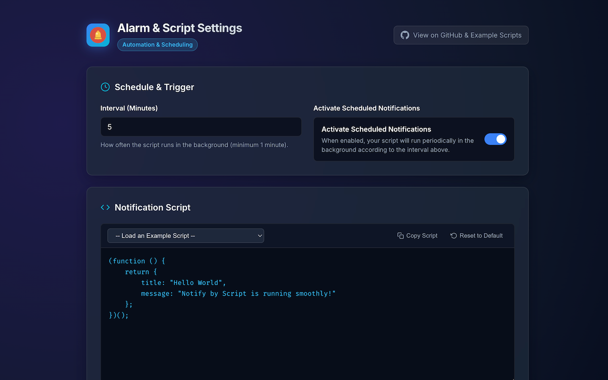
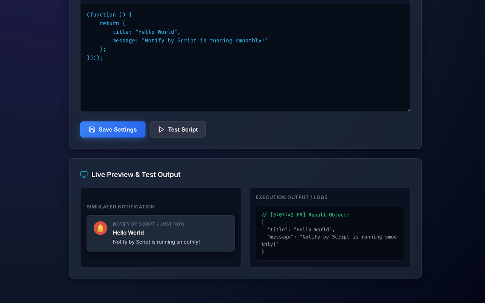
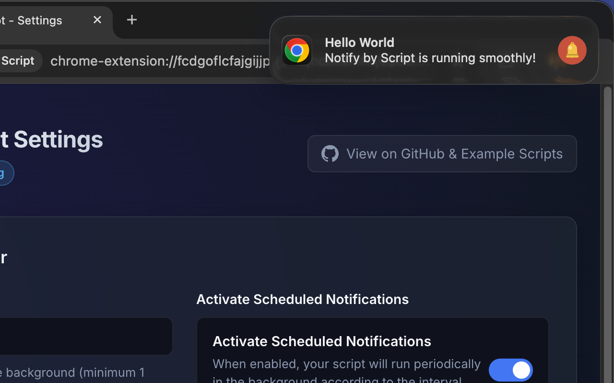

<div align="center">
  
  <h1>Notify by Script</h1>
  <p><strong>Scheduled background alarms and custom desktop notifications powered by user scripts.</strong></p>

[](https://chromewebstore.google.com/detail/notify-by-script/idgiodaooapkmmipoahlcmggofokcilg)
[](manifest.json)
</div>

---

**Notify by Script** allows you to schedule background alarms in Chrome and evaluate custom JavaScript functions to
generate desktop notifications. It runs user scripts securely inside a sandboxed iframe adhering to Chrome Manifest V3
Content Security Policy (CSP).

---

## ✨ Features

- **Modern JavaScript Execution**: Supports modern `async/await` functions, Promises, and `fetch()` requests.
- **Customizable Intervals**: Schedule execution from 1 minute up to 24 hours using `chrome.alarms`.
- **Conditional Notifications**: Return `{ title, message }` to display a notification, or return `undefined`/`null` to
  silently skip a cycle.
- **Live Simulator & Console**: Test scripts instantly within the Options page with live preview and error logs.
- **Pre-built Templates**: One-click presets for website health checks, crypto/currency trackers, hydration reminders,
  and conditional checks.
- **Multi-Language (i18n)**: Fully localized in English and Turkish.
- **Zero Dependencies / Privacy First**: Pure Vanilla JS, runs entirely locally on your device with zero telemetry.

---

## 🚀 Use Cases & Examples

### 1. Website / API Health Check (`fetch` & `async/await`)

Check if your website or API endpoint is responsive:

```javascript
(async function () {
    try {
        const response = await fetch("https://your-website.com/api/health");
        return {
            title: "Health Check",
            message: "Service is UP (Status: " + response.status + ")"
        };
    } catch (err) {
        return {
            title: "Health Check ALERT",
            message: "Service DOWN: " + err.message
        };
    }
})();
```

---

### 2. Conditional Notification (Alert only on failure)

Only show a notification when something goes wrong:

```javascript
(async function () {
    try {
        const response = await fetch("https://your-website.com");
        if (response.status !== 200) {
            return {
                title: "Website Alert",
                message: "Unexpected status code: " + response.status
            };
        }
    } catch (err) {
        return {
            title: "Website Down Alert",
            message: "Could not reach server: " + err.message
        };
    }
    // Returning nothing skips displaying a notification for this cycle
})();
```

---

### 3. Public API / Crypto Price Tracker

Query a public REST API (e.g., CoinGecko) to get live prices:

```javascript
(async function () {
    try {
        const res = await fetch("https://api.coingecko.com/api/v3/simple/price?ids=bitcoin&vs_currencies=usd");
        const data = await res.json();
        const price = data?.bitcoin?.usd;
        return {
            title: "BTC / USD Price",
            message: "Current Price: $" + (price ? price.toLocaleString() : "N/A")
        };
    } catch (err) {
        return {
            title: "Crypto Tracker Error",
            message: "Fetch failed: " + err.message
        };
    }
})();
```

---

### 4. Hydration & Health Reminder

Remind yourself to take a break and drink water while working:

```javascript
(function () {
    const reminders = [
        "Time for a quick stretch and a glass of water! 💧",
        "Stay hydrated! Your brain works better with water. 🥤",
        "Take a deep breath and drink some water! 🌊"
    ];
    return {
        title: "Hydration Reminder",
        message: reminders[Math.floor(Math.random() * reminders.length)]
    };
})();
```

---

## 📸 Screenshots

<div align="center">
  
  <p><em>1. Modern dark interface with customizable interval and active schedule toggle</em></p>
  <br />
  
  <p><em>2. One-click preset script templates with async/await and fetch support</em></p>
  <br />
  
  <p><em>3. Instant script evaluation with live notification simulator and execution console</em></p>
</div>

---

## 📦 Installation & Development

1. Clone the repository:
   ```bash
   git clone https://github.com/ufuk/notify-by-script.git
   ```
2. Open Google Chrome and navigate to `chrome://extensions`.
3. Enable **Developer mode** in the top right corner.
4. Click **Load unpacked** and select the `notify-by-script` directory.
5. Click the extension icon or open its Options page to configure your script!

---

## 🔒 Privacy Policy

**Notify by Script** does not collect, store, transmit, or sell any personal data, browsing history, or analytics. User
scripts and configuration options are saved locally in your browser via `chrome.storage.sync`. All script evaluations
take place locally in an isolated sandboxed iframe.
